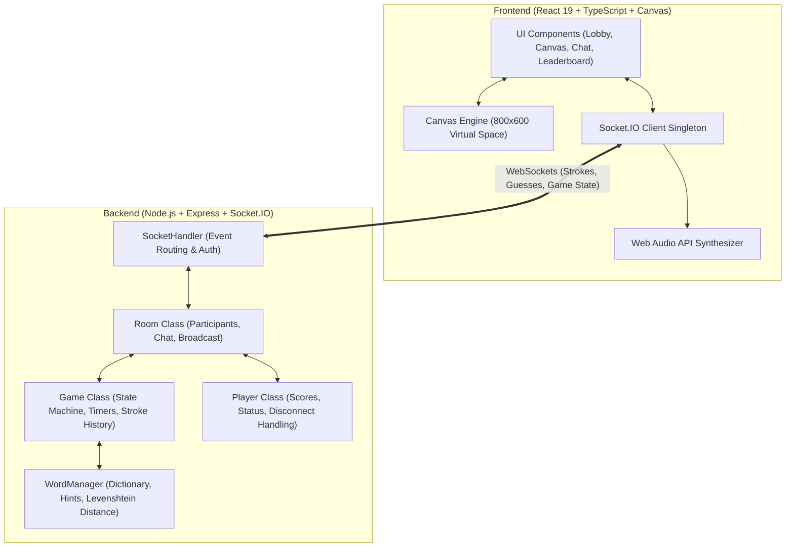

# 🎨 Skribbl.io Full-Stack Multiplayer Clone

A production-ready, full-stack multiplayer drawing and guessing game built with **React**, **TypeScript**, **Node.js**, **Express**, **Socket.IO**, and the **HTML5 Canvas API**.

---

## 📋 Table of Contents

1. [Features Breakdown](#-features-breakdown)
2. [Tech Stack](#-tech-stack)
3. [Architecture Overview](#-architecture-overview)
4. [Socket.IO Event Reference](#-socketio-event-reference)
5. [Drawing & Canvas Synchronization Mechanics](#-drawing--canvas-synchronization-mechanics)
6. [Word System & Scoring Logic](#-word-system--scoring-logic)
7. [Project Structure](#-project-structure)
8. [Local Installation & Setup](#-local-installation--setup)
9. [Running Automated E2E Tests](#-running-automated-e2e-tests)
10. [Production Deployment Guide (Vercel + Render)](#-production-deployment-guide-vercel--render)

---

## ✨ Features Breakdown

### 1. Multiplayer Rooms & Lobby
- **Public & Private Rooms**: Create open rooms discoverable in the public lobby browser, or invite-only private rooms.
- **Join via Code or Direct Link**: Join using a 6-character room code or via shareable invitation link (`?room=ROOM_CODE`).
- **Interactive Avatar Customizer**: Customize creature avatar colors, eye expressions (wink, shades, wide, sleepy, arches), and mouths (teeth, tongue, smirk, open, smile) rendered dynamically via SVG.
- **Configurable Room Settings**:
  - Max Players (2–20)
  - Rounds (2–10)
  - Draw Time (15–240 seconds)
  - Word Choices (1–5 choices per turn)
  - Hints Count (0–5 revealed letters, or disabled)
  - Custom Words (host-provided words bank)
- **Host Controls**: Host migration if the creator disconnects; host-only game start and restart buttons.

### 2. Turn-Based Game Loop & Word Selection
- **Role Rotation**: Each round, every connected player gets a turn to draw in sequence.
- **Word Selection Phase**: Drawer receives 3 curated word choices with difficulty and category tags. Words remain strictly secret on the server; guessers see "Player is choosing a word...".
- **Dynamic Letter Blanks & Hints**: Guessers see letter blanks (e.g., `_ _ _ _ _ _`) with total character count. Letters reveal progressively at time thresholds (e.g., 50% and 25% time left).
- **Round Transitions & Winner Podium**: Turn results show score breakdowns (+points this turn); game over triggers an Olympic-style top-3 podium with celebration confetti!

### 3. Real-Time HTML5 Canvas Drawing
- **Device-Independent Virtual Coordinate System**: Normalized 800×600 virtual resolution guarantees 1:1 stroke precision across desktop, tablets, and phones.
- **Drawing Tools**:
  - Smooth Brush / Pen with quadratic line joins and round caps.
  - 4 Brush Sizes (S: 3px, M: 8px, L: 16px, XL: 30px).
  - 22 Vibrant Skribbl Color Palette + Native HTML5 Custom Hex Color Picker.
  - Eraser Tool.
  - Flood Fill Bucket (pixel-manipulation queue-based 4-way flood fill).
  - Undo Last Stroke (synchronized across all clients).
  - Clear Canvas (drawer-only action, broadcasted).
- **Late Joiner & Reconnect Sync**: Canvas stroke history is preserved on the server so players who join mid-round receive the full drawing history immediately.

### 4. Chat & Guessing Engine
- **Server-Side Validation**: Guesses are trimmed, lowercased, and validated on the backend.
- **Anti-Cheat & Confidentiality**: The secret word is never sent to guessers. When a player guesses correctly, their guess is suppressed from chat and replaced with a green notification: `"🎉 [Player] guessed the word!"`.
- **Spoiler Shield**: Players who have already guessed can chat freely with each other and the drawer without leaking the word to players who are still guessing.
- **Fuzzy Close Guess Detection**: Utilizes Levenshtein edit distance algorithms. If a guess is within 1–2 edits of the secret word, a private whisper is displayed: `"'[word]' is very close!"`.
- **Time-Decay Scoring System**: Earlier guesses earn more points based on remaining draw time (`150–500 pts`), first guesser gets a `+75 pt` bonus, and the drawer receives `40%` reward for each successful guess.

### 5. Web Audio API Sound Synthesizer
- Zero external MP3/WAV dependencies! Uses browser Web Audio API oscillator synthesis:
  - Pleasant chime on correct guess
  - Alert notification on close guess
  - Woodblock tick during the final 5-second countdown
  - Fanfare arpeggio on round start and game over podium
  - Mute/Unmute audio toggle with persistent state in `localStorage`

---

## 🛠 Tech Stack

| Layer | Technology | Purpose |
|---|---|---|
| **Frontend** | React 19 + TypeScript + Vite | Component hierarchy, typed state management, fast bundling |
| **Styling** | Custom CSS3 | Authentic playful Skribbl.io aesthetic with responsive layouts |
| **Icons & Effects** | Lucide-React + Canvas-Confetti | Modern UI icons and celebratory victory animations |
| **Audio** | HTML5 Web Audio API | Low-latency client-side sound effects synthesis |
| **Canvas** | HTML5 Canvas 2D API | Custom vector drawing, flood fill, stroke history replay |
| **Backend** | Node.js + Express | REST endpoints, health probes, static assets |
| **Real-time Sync** | Socket.IO 4.8 | Bidirectional low-latency WebSocket communication |
| **Language** | TypeScript (ES2022) | Full end-to-end type safety |

---

## 🏛 Architecture Overview



### Server-Side Object-Oriented Design (OOP)
1. **`Room`**: Encapsulates room lifecycle, participant map, host delegation, chat history buffer, and broadcast helpers.
2. **`Game`**: Implements the state machine (`LOBBY` ➔ `SELECTING_WORD` ➔ `DRAWING` ➔ `ROUND_END` ➔ `GAME_OVER`), turn ordering, timer countdowns, hint scheduling, and canvas stroke history.
3. **`Player`**: Represents participant state, socket bindings, avatar parameters, turn scores, and connection flags.
4. **`WordManager`**: Curated database of 100+ categorised words across Animals, Food, Objects, Nature, Fantasy, and Sports, plus host custom words. Computes hints and Levenshtein edit distance.
5. **`SocketHandler`**: Validates client payloads, handles disconnections gracefully, and enforces security (preventing word leaks).

---

## 🔌 Socket.IO Event Reference

### Room & Lobby Events
| Event Name | Direction | Payload | Description |
|---|---|---|---|
| `create_room` | Client ➔ Server | `{ hostName, avatar, isPrivate, settings }` | Creates a room and registers host |
| `join_room` | Client ➔ Server | `{ roomId, playerName, avatar }` | Joins an existing room |
| `get_public_rooms` | Client ➔ Server | `{}` | Requests list of joinable public rooms |
| `update_settings` | Client ➔ Server | `Partial<RoomSettings>` | Host updates room settings |
| `start_game` | Client ➔ Server | `{}` | Host starts the game |
| `restart_game` | Client ➔ Server | `{}` | Host restarts game back to lobby |
| `player_joined` | Server ➔ Clients | `{ player, players }` | Broadcasted when a player enters |
| `player_left` | Server ➔ Clients | `{ playerId, players }` | Broadcasted when a player leaves |
| `players_updated` | Server ➔ Clients | `{ players, hostId }` | Updated participant leaderboard |

### Game State Events
| Event Name | Direction | Payload | Description |
|---|---|---|---|
| `game_state` | Server ➔ Clients | `GameStatePayload` | Current round, drawer, timer, word (drawer only), hints (guessers) |
| `timer_tick` | Server ➔ Clients | `{ timeLeft }` | 1-second countdown clock tick |
| `word_chosen` | Client ➔ Server | `{ word }` | Drawer selects word choice |
| `hint_revealed` | Server ➔ Clients | `{ hints }` | Server reveals an unmasked letter hint |
| `round_end` | Server ➔ Clients | `RoundEndPayload` | Turn ended; displays word and score gains |
| `game_over` | Server ➔ Clients | `GameOverPayload` | All rounds finished; triggers winner podium |

### Drawing Events
| Event Name | Direction | Payload | Description |
|---|---|---|---|
| `draw_start` | Client ➔ Server ➔ Clients | `{ x, y, color, size, tool }` | Drawer begins a new stroke |
| `draw_move` | Client ➔ Server ➔ Clients | `{ x, y }` | Drawer continues stroke path |
| `draw_end` | Client ➔ Server ➔ Clients | `{}` | Drawer releases pointer |
| `draw_undo` | Client ➔ Server ➔ Clients | `{}` | Drawer removes last stroke |
| `canvas_clear` | Client ➔ Server ➔ Clients | `{}` | Drawer resets canvas to blank |
| `draw_fill` | Client ➔ Server ➔ Clients | `{ x, y, color }` | Drawer triggers flood fill bucket |
| `request_canvas_history` | Client ➔ Server | `{}` | Late joiner requests turn stroke history |
| `canvas_history` | Server ➔ Client | `{ strokes }` | Replays all strokes onto the canvas |

### Chat & Guessing Events
| Event Name | Direction | Payload | Description |
|---|---|---|---|
| `send_message` | Client ➔ Server | `{ text }` | Player submits chat or guess |
| `chat_message` | Server ➔ Clients | `ChatMessage` | Broadcast message or system notification |
| `guess_result` | Server ➔ Clients | `{ correct, close, points, ... }` | Guess outcome notification |

---

## 🎯 Drawing & Canvas Synchronization Mechanics

1. **Logical Virtual Canvas**: The HTML5 `<canvas>` buffer is fixed at `800 × 600` pixels. CSS renders it responsively within its container using `object-fit: contain`.
2. **Coordinate Normalization**: Pointer events calculate normalized coordinates:
   $$\text{x} = (\text{clientX} - \text{rect.left}) \times \left(\frac{800}{\text{rect.width}}\right)$$
   $$\text{y} = (\text{clientY} - \text{rect.top}) \times \left(\frac{600}{\text{rect.height}}\right)$$
   This guarantees that drawings are identical across varying screen sizes and pixel densities.
3. **Flood Fill Algorithm**: Implements a queue-based 4-way Breadth-First Search (BFS) operating directly over the `CanvasRenderingContext2D` `ImageData` buffer:
   - Reads target pixel RGB.
   - Replaces matching adjacent pixels with fill color.
   - Emits normalized seed point `(x, y)` to all room participants.
4. **Stroke Replay on Reconnect**: The backend accumulates strokes in `Game.strokes`. Whenever a client joins or triggers undo, the canvas is repainted deterministically.

---

## 📊 Word System & Scoring Logic

### Word Hints
- Hints reveal progressively throughout the turn.
- A random hidden letter index is revealed at predetermined time intervals (e.g. at 50% and 25% remaining time).
- Space and hyphen characters (` `, `-`) are automatically exposed so compound words remain readable (e.g., `_ _ _   _ _ _ _` for "ICE CREAM").

### Scoring Formula
When a player guesses correctly:
$$\text{Base Points} = \text{round}\left(150 + \left(\frac{\text{Time Left}}{\text{Draw Time}}\right) \times 350\right)$$
- First Guesser Bonus: `+75 pts`
- Drawer Reward: `40%` of base points for every player who guesses correctly.

---

## 📁 Project Structure

```
strata-rag-widget/
├── backend/
│   ├── src/
│   │   ├── handlers/
│   │   │   └── SocketHandler.ts     # Socket.IO event router & validators
│   │   ├── models/
│   │   │   ├── Game.ts              # Game state machine, timers, scoring
│   │   │   ├── Player.ts            # Player model & score tracking
│   │   │   └── Room.ts              # Room management, participants, chat
│   │   ├── services/
│   │   │   └── WordManager.ts       # Categorized words, hints & Levenshtein
│   │   ├── types.ts                 # Shared TypeScript interfaces
│   │   └── index.ts                 # Express & Socket.IO server entrypoint
│   ├── test-e2e.ts                  # Automated end-to-end integration test
│   ├── .env.example                 # Backend environment variable template
│   ├── package.json                 # Backend dependencies & scripts
│   ├── render.yaml                  # Render deployment configuration
│   └── tsconfig.json                # Backend TypeScript configuration
├── frontend/
│   ├── src/
│   │   ├── components/
│   │   │   ├── Avatar.tsx           # SVG customizable player avatar
│   │   │   ├── AvatarCustomizer.tsx # Character creation interface
│   │   │   ├── ChatBox.tsx          # Chat feed & guessing input
│   │   │   ├── DrawingCanvas.tsx    # HTML5 Canvas with tools & sync
│   │   │   ├── GameOverModal.tsx    # Podium & victory confetti
│   │   │   ├── Header.tsx           # Status bar, round counter, word blanks
│   │   │   ├── HomeView.tsx         # Landing page & public room browser
│   │   │   ├── LobbyView.tsx        # Room lobby & invite link sharing
│   │   │   ├── PlayerList.tsx       # Live leaderboard & drawer status
│   │   │   ├── RoomSettingsModal.tsx# Host configuration modal
│   │   │   └── WordSelectorModal.tsx# Drawer 3-word choice dialog
│   │   ├── services/
│   │   │   ├── socket.ts            # Socket.IO client singleton
│   │   │   └── sound.ts             # Web Audio API sound synthesis
│   │   ├── App.tsx                  # Main game view controller
│   │   ├── index.css                # Skribbl.io design system & styles
│   │   ├── main.tsx                 # React DOM mount point
│   │   ├── types.ts                 # Frontend TypeScript interfaces
│   │   └── vite-env.d.ts            # Vite client type definitions
│   ├── .env.example                 # Frontend environment template
│   ├── index.html                   # HTML entrypoint with custom fonts
│   ├── package.json                 # Frontend dependencies & scripts
│   ├── tsconfig.json                # Frontend TypeScript configuration
│   ├── vercel.json                  # Vercel SPA routing configuration
│   └── vite.config.ts               # Vite configuration
├── package.json                     # Root monorepo convenience scripts
├── .gitignore                       # Git ignore rules
└── README.md                        # Documentation & setup guide
```

---

## 🚀 Local Installation & Setup

### Prerequisites
- **Node.js**: v18.0.0 or higher (Node v20+ recommended)
- **npm**: v9.0.0 or higher

### 1. Clone the repository
```bash
git clone <repo-url>
cd strata-rag-widget
```

### 2. Install all dependencies
```bash
npm run install:all
```
*(Or install separately with `cd backend && npm install` and `cd frontend && npm install`)*

### 3. Configure Environment Variables
- **Backend**:
  Copy `backend/.env.example` to `backend/.env`:
  ```bash
  PORT=5000
  NODE_ENV=development
  CLIENT_URL=http://localhost:5173
  ```
- **Frontend**:
  Copy `frontend/.env.example` to `frontend/.env`:
  ```bash
  VITE_BACKEND_URL=http://localhost:5000
  ```

### 4. Start the Development Servers
In two separate terminals:

**Terminal 1 (Backend Server)**:
```bash
npm run dev:backend
```
*Server starts at `http://localhost:5000`*

**Terminal 2 (Frontend Client)**:
```bash
npm run dev:frontend
```
*Vite client starts at `http://localhost:5173`*

Open `http://localhost:5173` in your browser. Open a second incognito window to test multiplayer drawing and guessing!

---

## 🧪 Running Automated E2E Tests

The project includes an end-to-end integration test (`backend/test-e2e.ts`) that launches an in-memory game server and simulates 2 real Socket.IO clients (Alice and Bob):
- Creates room & verifies join
- Starts game & verifies word confidentiality (guesser cannot see secret words)
- Synchronizes drawing strokes in real time
- Tests stroke undo
- Tests fuzzy close guess whisper (`"Wizarz"` ➔ `"very close!"`)
- Tests correct guess scoring & turn conclusion

Run the test suite with:
```bash
npm run test:e2e
```

---

## 🌐 Production Deployment Guide (Vercel + Render)

### Architecture in Production
- **Frontend**: Hosted on **Vercel** (Static SPA with global CDN edge caching).
- **Backend**: Hosted on **Render** (Persistent Node.js web service with continuous WebSocket support).

> **Why a separate Node server?**
> Vercel functions are serverless and spin down after requests finish; they do not maintain long-lived stateful TCP/WebSocket connections. Render provides a long-running instance required for persistent Socket.IO room states and timers.

---

### Step 1: Deploy Backend on Render

1. Create a free account on [Render.com](https://render.com).
2. Click **New +** ➔ **Web Service** and connect your GitHub repository.
3. Configure the service settings:
   - **Root Directory**: `backend`
   - **Environment**: `Node`
   - **Build Command**: `npm install && npm run build`
   - **Start Command**: `npm start`
4. Add the following **Environment Variables**:
   - `NODE_ENV`: `production`
   - `PORT`: `10000`
   - `CLIENT_URL`: `https://your-frontend-app.vercel.app` *(update once frontend is deployed)*
5. Click **Create Web Service**. Note your Render backend URL (e.g., `https://skribbl-clone-backend.onrender.com`).

---

### Step 2: Deploy Frontend on Vercel

1. Create an account on [Vercel.com](https://vercel.com).
2. Click **Add New...** ➔ **Project** and import your repository.
3. Configure the project settings:
   - **Framework Preset**: `Vite`
   - **Root Directory**: `frontend`
   - **Build Command**: `npm run build`
   - **Output Directory**: `dist`
4. Add the **Environment Variable**:
   - `VITE_BACKEND_URL`: `https://skribbl-clone-backend.onrender.com` *(your Render backend URL)*
5. Click **Deploy**. Vercel will build and deploy your app.

---

### Step 3: Connect Frontend and Backend
1. Go back to Render settings for your backend service.
2. Update `CLIENT_URL` to your live Vercel domain (e.g. `https://skribbl-clone.vercel.app`).
3. Your full-stack Skribbl clone is now live and fully operational worldwide!

---

## 📄 License
This project is open-source and available under the **MIT License**.
